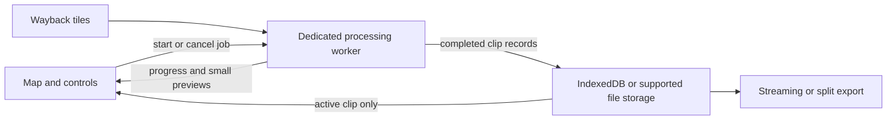

GeoMap-Detector performance review, 5 November 2026

The most useful changes are to bound raster and result memory, keep processing off the map's UI thread, and stop rebuilding layers unnecessarily. The application can keep its Leaflet interface and static hosting while these changes are made.

Current implementation status, dependencies, and acceptance evidence are maintained in [the task tracker](./tasks.md). Findings below describe the review snapshot; consult the tracker for subsequent fixes.

This review covers repository revision `be3bd28` and the JavaScript served at [the live portal](https://tri-ctrl.github.io/GeoMap-Detector/). The HTML matched the checkout byte for byte. The deployed JavaScript differed: it lacked the checkout's exact-AOI deduplication and explicit model-download handling. File references below refer to the checkout. This document proposes changes; application code was not changed as part of this review.

The browser check used an isolated desktop headless Chrome 157 profile, a 1440 × 1000 viewport, and disabled HTTP caching. It exercised initial loading, repeated sample loading, repeated release selection, one small imagery-only job, and result-image toggling. It did not benchmark full-size detection, mobile browsers, training, the Python service, or sustained GPU memory use. Timings are one observation on this machine and connection, not population averages or promised improvements. Measurements are in [performance-review-measurements.json](./performance-review-measurements.json).

The current feature flow is understood as follows:

| Area | Current implementation | Review implication |
| --- | --- | --- |
| AOIs | Import GeoJSON, KML, zipped SHP, CSV; buffer points; draw polygons; save to localStorage | Existing duplicate prevention is absent from deployment; stable AOI identities are also needed |
| Wayback | Download release configuration; browse dates; find local imagery changes; choose latest/all changes/selected releases | Metadata and tile latency affect map startup; repeated date changes rebuild the basemap |
| Detection | Full-AOI mosaic; 1024 px sliding windows; YOLO11 OBB on WebGPU with WASM fallback; polygon NMS | Large canvases, preprocessing, and suppression need separate budgets |
| Results | Keep per-clip GeoJSON, PNG, JPEG preview, optional TIFF in the tab; overlay the PNG | History grows without a removal or eviction path; displaying full PNGs decodes large images again |
| Annotation | Select, accept, reject, reclassify, edit, draw; save reviewed features | Selection restyles every detection; persistence repeatedly serializes the whole annotation set |
| Training | Browser dataset ZIP and external training instructions; optional server fine-tuning | Dataset generation has the same canvas/ZIP pressure; train/validation isolation needs attention |
| Export | Job ZIP, GeoJSON, AOIs, CSV, georeferenced PNG/TIFF | Existing exports build whole archives in memory and recompress compressed imagery |
| Optional backend | FastAPI, requests/threaded tile fetching, Ultralytics, filesystem outputs/training | This is separate from the public Pages frontend; frontend fixes do not resolve backend concurrency |

The browser observed first contentful paint at 3.66 s. The first polling observation satisfying both a loaded map tile and the two model options was at 8.74 s; this is not the time when every map tile finished. The Wayback configuration request took 2.32 s, and some initial tile requests took about 3.6 s. The largest observed startup long task lasted 359 ms, but its exact function was not traced. Network latency and main-thread work both matter.

Both deployed model files also returned HTTP 200 to separate HEAD requests: [nano](https://tri-ctrl.github.io/GeoMap-Detector/models/yolo11n-obb.onnx), 11,003,776 bytes, and [small](https://tri-ctrl.github.io/GeoMap-Detector/models/yolo11s-obb.onnx), 39,195,915 bytes. These are direct download addresses. Availability was checked without loading model weights or benchmarking inference during this review.

The repeated-interaction checks were more conclusive than the timing sample: loading the UAE sample twice produced 12 AOIs; selecting the already active imagery date five times added five tile layers; toggling the result image five times added five more basemap layers. A small 374 × 413 px imagery-only clip completed without a JavaScript exception. The image view created one blob URL and revoked none; toggling reused that URL rather than creating a new URL on every toggle.

The main findings, in implementation order:

| Priority | Finding and evidence | Recommended change |
| --- | --- | --- |
| P1 | [buildRaster](../frontend/engine.js#L121) allocates an entire AOI canvas; its tile limit does not bound every intermediate allocation | Add pixel and dimension budgets, then process large AOIs in bounded blocks |
| P1 | [processClip](../frontend/engine.js#L334) always generates PNG and preview, plus TIFF by default; [BJOBS](../frontend/app.js#L22) retains every result | Persist outputs as each clip completes; retain only metadata and the current display image in memory |
| P1 | [writeGeoTIFF](../frontend/engine.js#L299), preprocessing, and [NMS](../frontend/engine.js#L168) run in the window thread | Move the processing pipeline into a dedicated worker with OffscreenCanvas |
| P1 | [setWayback](../frontend/app.js#L58) replaces the tile layer even for the same release; [openClip](../frontend/app.js#L403) calls it on image toggles | Return early for an unchanged release and update the existing layer only when the release changes |
| P1 | [blobURL](../frontend/app.js#L401), the session cache, and custom-model storage have no explicit eviction lifecycle | Add view disposal, job removal, bounded model caching, and `session.release()` |
| P1 | The publish workflow calls `export_onnx.py --check`, but the current script does not accept `--check` | Repair the asset-validation entry point before publishing performance changes |
| P2 | [localChanges](../frontend/engine.js#L76) has no cancellation or timeout; canvas release happens only on the successful path | Propagate cancellation and use cleanup in `finally`, after sibling work has stopped |
| P2 | [renderAois](../frontend/app.js#L125) rebuilds all AOI layers; [select](../frontend/app.js#L447) restyles all detections | Keep layers indexed by ID; update only changed and selected layers |
| P2 | [getAnnotations](../frontend/app.js#L422) and `upsertLocal` read/write the complete annotation collection | Move large records to IndexedDB and query by AOI/release |
| P2 | [fetchTile](../frontend/engine.js#L93) puts tiles in Cache Storage without application eviction | Add a storage budget, recency tracking, cache-size reporting, and a clear-cache action |
| P2 | [exportJobZip](../frontend/engine.js#L355) retains the full archive and DEFLATE-compresses every file | Store already compressed images without recompressing; add per-clip/split exports, then true streaming output |

The raster budget should be addressed before increasing concurrency. From the user's successful run, one RGBA buffer has the following lower-bound storage. These figures are arithmetic estimates, not measured browser process memory. The clips run sequentially, so the rows must not be summed as concurrent raster memory.

| AOI | Logged dimensions | One RGBA buffer |
| --- | --- | --- |
| DXB | 9322 × 6391 | 227.3 MiB |
| SHJ | 5966 × 4745 | 108.0 MiB |
| AUH | 8762 × 6963 | 232.7 MiB |
| DWC | 9321 × 6988 | 248.5 MiB |
| JEA_PORT | 5593 × 3601 | 76.8 MiB |
| RASHID_PORT | 4288 × 3712 | 60.7 MiB |

The 1200-tile setting allows approximately 300 MiB of tile-area RGBA pixels before accounting for inference, temporary image data, preview canvases, encoded blobs, or archive buffers. PNG/TIFF blobs are compressed and should not be counted as additional full RGBA copies. Opening a full-resolution PNG can nevertheless require another large decoded image surface.

Introduce `maxPixels`, a maximum dimension, and an estimated peak-memory check before creating a canvas. Make these configurable and calibrate them on supported devices; 16–32 megapixels is a candidate starting budget to test, not a universal safe limit. Verify the limits again after zoom selection: `pickZoom` currently returns zoom 10 even if its tile target was never met. Large AOIs should be split into bounded mosaics while keeping the requested imagery resolution. A worker alone will not reduce the memory required for an oversized canvas.

Generate a separate, unannotated display image at viewport-appropriate resolution. The current JPEG preview has detection boxes burned into it, so it should not be reused unchanged underneath editable vectors. For the logged DXB aspect ratio, a 2048 px wide display image would require roughly 11 MiB of RGBA pixels instead of 227 MiB. Keep native-resolution outputs in storage for export or use tiled display imagery when full-resolution zoom inspection is needed.

The proposed processing ownership is:

The worker should own tile requests, bounded mosaics, preprocessing, ONNX sessions, decoding/NMS, and TIFF encoding. Use one active clip pipeline initially; retain bounded tile-fetch concurrency rather than processing several full AOIs at once. Pass transferable ArrayBuffers when moving large binary data. Send cancellation messages to a controller inside the worker and checkpoint completed clips before moving on. OffscreenCanvas is already created where supported, but the present code creates and uses it in the main thread; its availability alone does not move work off that thread. [MDN documents worker use of OffscreenCanvas](https://developer.mozilla.org/en-US/docs/Web/API/OffscreenCanvas).

For ONNX Runtime, use an explicit worker for WebGPU. Setting `ort.env.wasm.proxy = true` is not the WebGPU solution: the documented proxy worker does not support the WebGPU execution provider. The live page reported `crossOriginIsolated === false` and `numThreads === 1`; raising the number alone will not enable multithreaded WASM. Consider isolation headers only after checking all external assets' compatibility. A worker can still improve responsiveness with single-threaded WASM. [ONNX Runtime flags and worker limitations](https://onnxruntime.ai/docs/tutorials/web/env-flags-and-session-options.html).

Define resource owners rather than relying on garbage collection timing. A clip-view disposer should remove the overlay, revoke its URL when no view uses it, finish/disable editing, and clear the selected layer. The existing download helper already revokes its temporary download URLs; the missing lifecycle is the cached image-view URL. A WeakMap does not revoke a browser object URL. The browser check establishes the missing cleanup path, not a measured leak rate. [MDN explains when object URLs should be revoked](https://developer.mozilla.org/en-US/docs/Web/API/URL/revokeObjectURL_static).

A job disposer should remove in-memory image and feature references once their saved records are available, with an explicit Delete job action for persisted records. Add a configurable byte budget, not just a fixed job count. Avoid automatically deleting the only copy of unsaved work. Persist each completed clip so closing a tab need not lose an entire job. LocalStorage can remain suitable for small UI preferences; its synchronous collection-wide annotation reads/writes should be replaced with indexed asynchronous storage as data grows. [Web Storage's synchronous behavior is documented by MDN](https://developer.mozilla.org/en-US/docs/Web/API/Web_Storage_API).

Keep one or a small bounded number of idle models. Evict only sessions with no inference in flight and await `session.release()`. Persist custom ONNX files before dropping the buffer needed to reload them. Deduplicate simultaneous model-load requests with a pending promise. The imported-file key currently uses only filename and size; different weights with the same filename and size can incorrectly reuse a cached model. Use a content hash or a unique import ID. Editing a custom model's class-name array also needs to update or invalidate the cached metadata. [ONNX Runtime exposes session release](https://onnxruntime.ai/docs/api/js/interfaces/InferenceSession.html).

Do not diagnose a GPU-tensor leak solely from the lack of `tensor.dispose()` in this code. Its current CPU-backed inputs and default outputs differ from explicitly retained GPU tensors. If GPU-buffer IO is introduced later, follow ownership-specific disposal rules; preallocated user-owned buffers and runtime-owned GPU outputs have different lifecycles. [ONNX Runtime GPU tensor ownership](https://onnxruntime.ai/docs/tutorials/web/ep-webgpu.html).

Map interactions need less work per action. Compare the requested release before changing `S.viewRel`; return without replacing the layer for an unchanged release. For a genuinely different release, update the existing tile layer URL or use a bounded two-layer transition that disposes the previous layer. Image visibility toggles should only add/remove the image overlay. They should not refetch annotations, fit the map, rebuild detections, or select the same basemap release again.

Keep AOI layers and detection layers in maps keyed by persistent IDs. AOI selection should restyle the previous and new selection instead of calling `renderAois` to rebuild everything. Detection selection should similarly restyle two objects, rather than every object on each acceptance/reclassification. Consider Leaflet's Canvas renderer for large inactive detection collections, with an editable selected-object layer, and verify Leaflet.Draw behavior before adopting it. Throttle coordinate HUD updates to animation frames. Use event delegation and list virtualization when measured list sizes justify it; the observed 198 release rows are less urgent than raster memory and repeated basemap replacement. [Leaflet 1.9.4 renderer and tile options](https://leafletjs.com/reference-1.9.4.html).

Startup should initialize the map independently of detection and export libraries. The HTML currently loads ONNX Runtime, fflate, and JSZip before `app.js`. Load ONNX Runtime when detection is requested, ZIP code when exporting, and TIFF code only when needed. Cache the dependency-load promises, show progress, and allow retries after failures. Store the most recent valid Wayback metadata locally for immediate map initialization, then refresh it in the background. Preconnect to the actual tile and metadata origins. The observed metadata/tile delays mean lazy-loading JavaScript alone will not remove all startup delay.

The tile cache is primarily a persistent-storage concern, not evidence of a JavaScript heap leak. Set an application byte/entry budget with recency-based eviction and expose storage use and Clear imagery cache. Keep annotation/result records separate from disposable tiles and prioritize preserving those records under quota pressure. Cache Storage does not provide application expiry automatically. Consider shared in-flight tile-request promises and polygon/tile intersection checks to avoid fetching the entire bounding rectangle of a narrow or irregular AOI. [MDN on explicit cache maintenance](https://developer.mozilla.org/en-US/docs/Web/API/Cache).

Cancellation and asynchronous UI ownership need explicit tests. `localChanges` should accept a signal and use request timeouts. Check cancellation even when tiles come from cache, between stages, and during block/chip loops. An error in one pooled fetch should stop and drain sibling work before releasing their canvas. Reset large canvases and close bitmaps in `finally`, including export and dataset failures. In `openClip`, abort the previous request or use an incrementing view-generation token; an earlier response must not overwrite the newly selected clip. Finish edits and clear stale selection references when leaving a clip.

Keep the existing preallocated float input array, then measure before optimizing inference further. Class selection currently filters decoded detections after inference; selecting fewer classes does not shrink the model's compute. The final global NMS compares each kept same-class detection against subsequent candidates, which can grow quadratically. Add a spatial candidate index while preserving confidence ordering and exact overlap checks. Do not lower overlap, chip size, confidence, or image resolution simply to advertise speed; validate recall on small aircraft, ships, and tile-edge objects. FP16 and graph-capture experiments belong after the memory/UI work and require provider/accuracy validation.

Export should write stored clip records incrementally. PNG, JPEG, and deflated TIFF usually gain little from another DEFLATE pass; use STORE for those entries and compression for JSON/text. First add per-clip exports and size-limited archive parts. Then add streaming ZIP output to a supported file destination, retaining a browser-compatible fallback. `JSZip.generateAsync({type: 'blob'})` still produces a complete archive blob; merely enabling ZIP streaming flags without streaming the final destination will not solve archive-size memory pressure. Export PNG or TIFF according to user choice, and account for the display image's separate storage requirements.

Some feature-correctness issues should be fixed with the performance work. `aoi_id` is derived from a sanitized name, so different AOIs can share export folders and detection IDs. Persist an AOI UUID; key result records by job, AOI ID, release ID, and model revision. Do not merge saved reviews into new model results solely by the existing name/release/confidence-rank IDs. Browser dataset splits currently distribute overlapping chips between train and validation, and tiny datasets copy a training chip into validation; use spatial or AOI groups and report when independent validation is unavailable. The rejected-only regions also need an explicit negative-example policy because rejected features are filtered before regions are built.

Useful product additions are a job-size estimate before Run, stage timings, downloadable per-clip outputs, resumable jobs, a storage meter, Delete job and Clear cache controls, and a diagnostic display of deployed revision, model revision, and provider. These address the observed failure modes directly and make future performance reports reproducible.

The optional Python service needs a separate queue rather than an unbounded thread per detection/training request. Bound GPU job concurrency, avoid concurrent access to a shared cached predictor without a supported execution strategy, cap model caches, and expire completed in-memory job records. Configure the requests connection pool for the tile concurrency and add filesystem tile-cache retention. Stream final GeoJSON records to disk for large jobs instead of keeping every feature until the end. Training annotation writes should be atomic and synchronized when requests can overlap. These recommendations come from code inspection; the backend was not load-tested.

The current validation state is important before any deployment. The 11 JavaScript tests pass. The Python test suite fails during import because `ultralytics` is unavailable locally, and the current exporter also lacks the `check_models` helper those tests expect. Independently, running its argument parser with an import-only Ultralytics stub confirms that `--check` exits with an unrecognized-argument error. The Pages workflow invokes that unsupported flag, including on restored-cache builds that skip dependency installation. Restore a dependency-free validation command or change the workflow to a real checker. The test files are currently untracked and should be deliberately included if they are intended to gate CI.

Implement the work in three stages:

1. Restore the deployment check; publish the existing duplicate fix; stop same-release layer rebuilding; separate image toggling from clip loading; add URL/view cleanup, stale-response protection, error-path canvas cleanup, and a job-removal flow. Add timing and byte counters so later changes have a baseline.
2. Add pixel/dimension budgets, bounded mosaic blocks, a processing worker, asynchronous result persistence, an unannotated display image, and chunked exports. Keep one active processing pipeline until measured memory and GPU behavior justify more concurrency.
3. Optimize indexed rendering, annotation queries, tile-cache eviction, candidate indexing for NMS, and optional model precision/runtime settings. Add resume and diagnostics once persistent record identities are reliable.

Acceptance checks should include 20 clip switches with editing and image toggles; repeated nano/small/custom model swaps; cancellation during cold fetches and cached fetches; TIFF/ZIP failure injection; repeated six-AOI jobs; a dense detection scene; and a smaller-memory/mobile browser. Track JavaScript heap, browser process/native memory, and GPU memory separately. Expect browsers/runtimes to retain reusable pools; the useful signal is a bounded plateau after disposal, not an exact return to the cold-start process size. Suggested targets, to calibrate on representative devices, are no avoidable application tasks over 50 ms during ordinary map interactions, under 100 ms for selection feedback, one active image URL per view, one active basemap layer outside a bounded transition, and storage/memory growth bounded by configured budgets.
